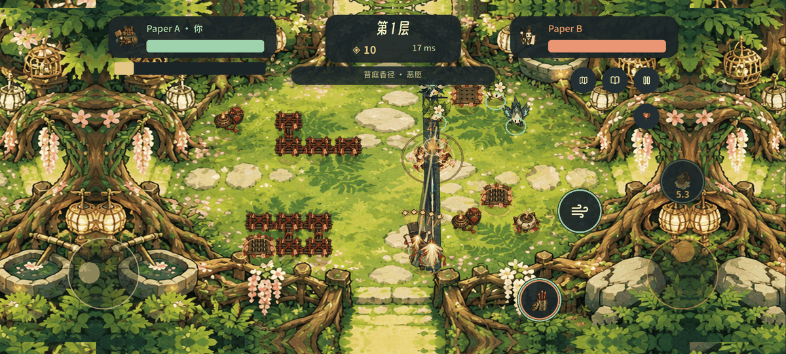
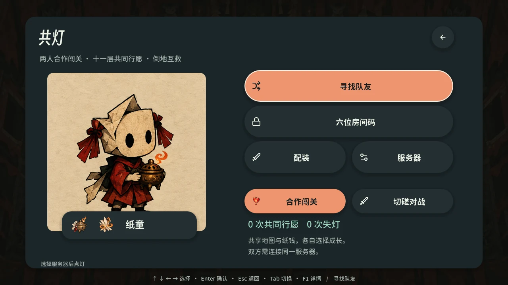
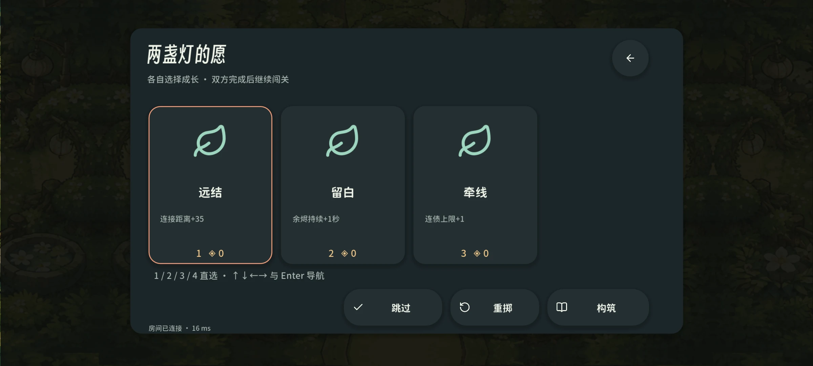
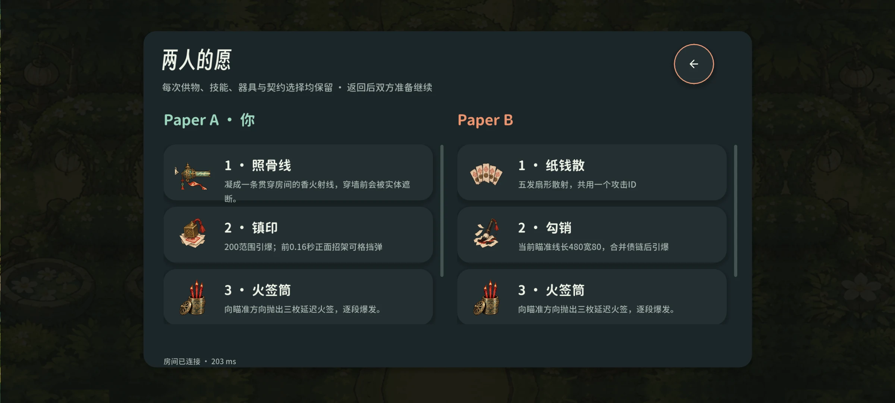
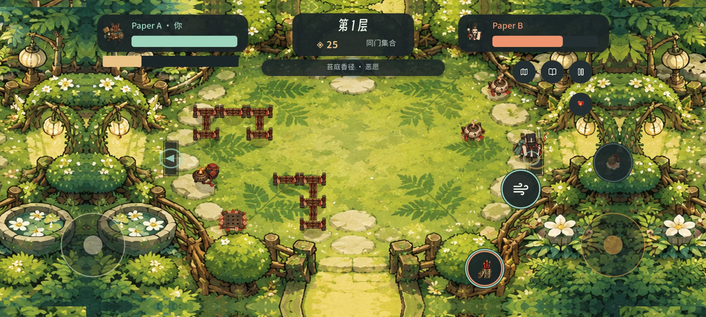
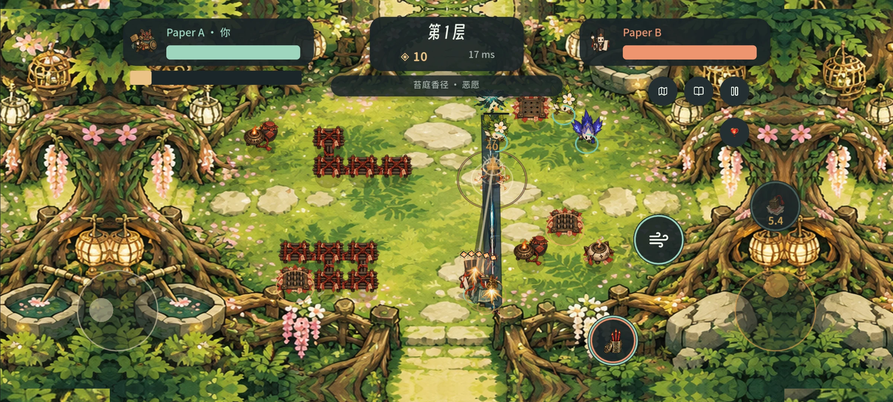

# 0.4.0 共灯合作交付

本轮把默认联机从「对灯」切换为**双人合作闯关**。双方共享真实十一层肉鸽的房间、敌人、掉落和金币，各自成长、购买、装备和救援；通过一起走到门口／阶梯推进。保留离线单人和可选对灯切磋。

Windows 客户端、Android APK 和 Windows 原生专用服务器使用相同 0.4.0 规则。源码与恢复设计见[第 41 篇](41-cooperative-architecture.md)，全部最终哈希与计数见[交付回执](reports/cooperative-2026-10-11/delivery.json)、[包体核对](reports/cooperative-2026-10-11/package-parity.json)和[发布清单](../releases/v0.4.0-alpha.1.manifest.json)。旧 0.3.0 发布保留原附件与标签。

## 实际原生流程

| 合作大厅 | 各自成长 |
| --- | --- |
|  |  |

| 双方成长历史 | 一起走门换房 |
| --- | --- |
|  |  |

本轮媒体由实际导出的 0.4.0 Windows EXE 运行，连接独立导出的服务端，用真实原生键盘／触控事件及第二个网络客户端驱动。GIF 为 20 张连续战斗捕获，以 100 ms 对照播放，无声；不是概念图。截图和原帧哈希见[媒体清单](reports/cooperative-2026-10-11/media-manifest.json)。长屏与双指为 Windows 原生夹具，不能称为 Android 实体设备验收。

## 验证范围

| 记录 | 覆盖 |
| --- | --- |
| [合作规则](reports/cooperative-2026-10-11/combat.json) | NPC、友伤、救援、共享奖励、物理门、交易、个人债约偿还、演化、32 武器归属、十一层结局与密集场景快照 |
| [真实传输](reports/cooperative-2026-10-11/transport.json) | 模式隔离、同码加入、移动／攻击、停战、双方恢复、断线选卡、过期候选拒绝、唯一团队结算和暂停时独立检查点 |
| [实际客户端](reports/cooperative-2026-10-11/native.json) | 大厅、配装、告知、匹配、WASD、方向射击、Q、Esc、Tab、I、数字选卡、右手触控、清房与双人走门、恢复、返回单人 |
| [实际服务端恢复](reports/cooperative-2026-10-11/recovery.json) | 崩溃、最新注册表损坏、最新房间损坏、旧连接接管和超时；完整玩家／共享房间状态一致 |
| [写盘故障](reports/cooperative-2026-10-11/storage.json) | 独立测试目录中制造可恢复写入失败，检查停战、拒绝事务、恢复与重新确认 |
| [短时负载](reports/cooperative-2026-10-11/load.json) | 本机两房真实合作 WebSocket 流量、模拟频率、处理耗时、积压和持久化错误；不是十一层长时压力或公网容量证明 |
| [PvP 规则](reports/cooperative-2026-10-11/duel-combat.json)、[PvP 客户端](reports/cooperative-2026-10-11/duel-native.json) | 可选对灯回归，保留其独立玩法 |
| [单人核心](reports/cooperative-2026-10-11/offline-core.json)、[键盘](reports/cooperative-2026-10-11/keyboard.json) | 离线核心和实际新 EXE 的完整键盘流程 |
| [APK](reports/cooperative-2026-10-11/android.json)、[跨包核对](reports/cooperative-2026-10-11/package-parity.json) | 签名、升级签名、权限、边到边、实际编译模块、运行数据及美术纹理一致 |

恢复复查发现暂停时重复提交注册表会使两代同时引用一个房间文件，已改为每代独立提交全体房间，重新进行实际服务端损坏回退。救援支持重复 E，不再因持续交互重置进度。长局结果按实际结算时间保留，双方在线的菜单暂停不会被断线期限误结束。

压力快照保留 240 发子弹和每人 256 条完整成长记录；只移除展示不使用的攻击配方、命中账册和重复成长，完整服务端保存不删减。压缩／展开大小的实际数值见合作规则报告的 `snapshot_metrics`。

## 运行与边界

下载[当前发布](https://github.com/wikigsroom/joss-debt/releases/tag/v0.4.0-alpha.1)，双方使用同版本客户端、同模式和同服务器。运行服务端 ZIP 中 `StartServer.cmd`，客户端进入「共灯 → 服务器」；同电脑用 `ws://127.0.0.1:18777`，手机或另一电脑用主机局域网 IPv4。手机 localhost 指自己。随后快速匹配或输入同一个六位码，并共同准备。

默认没有公网游戏主机；Vercel 隐私站不运行持续游戏服务器。公网需要常驻主机、有效 WSS 证书和目标主机容量验收。Android 为 **0.4.0 / code 7 调试签名**，实体手机安装、横屏、低端性能与跨端联机仍需真机验收。iOS 未发布新版 IPA，0.2.0 源码交接保持历史身份。十一层全路线的多人真人平衡和长时掉线测试仍待完成。

隐私政策 v1.5 已正式部署到 [xhz.sidcloud.cn](https://xhz.sidcloud.cn/privacy-policy)，运营主体吴国黎，邮箱 carzyg@outlook.com；Word 原模板渲染 13 页全部逐页查看，现行／历史正文、下载与资源共 13 项无认证 HTTPS 检查通过。详见[隐私审核](../legal/privacy-implementation-audit.md)和[公开核验](reports/cooperative-2026-10-11/privacy-https.json)。整个验证使用 Windows 原生工具，无 Docker、WSL、虚拟机或模拟器，没有打开浏览器标签页。

## English

0.4.0 defaults to the Co-Light cooperative campaign, with shared NPC rooms and coins, individual builds, nearby rescue, physical team doors and eleven-floor progression. Solo play and optional Duel remain available. The native Windows client, Android debug APK and standalone Windows server are bound to exact hashes in the delivery and release manifests.

The media comes from the actual exported Windows EXE with a separate exported server and a second live network client. The silent GIF uses 20 consecutive captures at 100 ms playback. Native touchscreen fixtures are not physical Android tests. Acceptance separately covers cooperative rules and real transport, packaged-client input and doors, packaged-server crash/corruption/reconnect/storage failure, local short load, PvP regression, solo keyboard flow and compiled Windows/APK parity.

A paused-checkpoint flaw was fixed by giving each registry generation independent room files. Repeated interaction preserves rescue progress, connected menu pauses have no disconnect deadline, and long campaign results are retained from settlement time. Full server recovery state remains complete while client presentation strips private simulation recipes and duplicate growth histories.

Run StartServer.cmd, select Co-Light and connect both clients to the same server/version. Same-PC play uses localhost; LAN phones use the server PC's IPv4. No default public game host, physical Android acceptance, human long-campaign balance or WAN test is claimed. Android is version 0.4.0/code 7, debug signed; iOS retains its historical 0.2.0 handoff. Privacy v1.5 is publicly available over HTTPS with the approved operator and contact.
