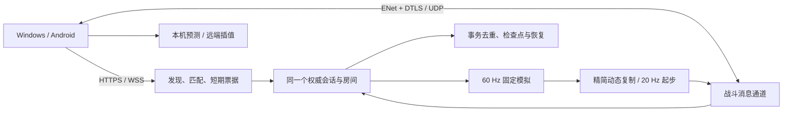

# 45 · 联机传输与同步重新选型

审查日期：2026-10-11。源码基线：`3e1d5eaf574202314cfa12fba4fd5b7cfd1511f6`；引擎：原生 Godot 4.7.2。目标平台：Windows、Android 原生客户端；主玩法：两人合作房间肉鸽，保留可选对灯。

**选型决定：战斗使用服务器裁定的 ENet＋DTLS，配套精简状态协议、固定 tick 本机预测与校正、远端插值；HTTPS／WSS 负责服务发现、匹配和连接票据。** netfox 作为同步层候选单独评估，Steam Networking 留给 Steam 版本，WebRTC 留给浏览器版本。不能把当前全量快照原封不动放进 UDP 后就宣称问题解决。

**本轮交付状态：** 完成联网研究、当前源码与历史公网证据复查、真实 UDP 弱网代理下的原生 ENet／DTLS 可行性实验，以及当前状态编码的原生测量。生产客户端和官方服务器仍使用 v0.5.0 WSS；本轮没有部署新 UDP 服务，也没有完成 Android 真机或新架构的公网游戏验收。

English decision: use a dedicated authoritative ENet/DTLS battle connection for native clients, with compact replication, fixed-tick prediction/reconciliation and buffered remote interpolation. Keep HTTPS/WSS for bootstrap and matchmaking. This is an evidence-backed architecture selection, not a completed production migration.

## 1. UDP 是否是正确方向

是。实时动作游戏的位置、瞄准和持续输入有明显的时效性：新位置到达后，早先位置通常已经失去价值。TCP 的可靠顺序交付会让后续字节等待丢失字节补齐；在单条 WebSocket 上，关键事务和频繁状态又共用这条流。UDP 允许应用决定哪些消息应该补发、哪些应该跳过。

但 UDP 本身不保证可靠、顺序、认证、加密或断线恢复。适合本项目的是在 UDP 上使用成熟的游戏传输层，再按消息用途配置可靠性。Godot 原生 ENet 支持 UDP 连接及可靠／非可靠通道，低层 `ENetConnection` 还提供 DTLS 配置；本轮验证使用的正是该接口。[Godot ENetMultiplayerPeer](https://docs.godotengine.org/en/stable/classes/class_enetmultiplayerpeer.html)、[ENetConnection](https://docs.godotengine.org/en/stable/classes/class_enetconnection.html)

传输层和同步算法需要分开选：**ENet 解决如何传送；预测、插值、校正、命中补偿解决收到数据后怎样呈现和裁定。** 单独换协议不能消除地理 RTT，也不能修复主线程停顿和每次复制整个世界的开销。

## 2. 当前实现为何会卡顿

### 2.1 已确认的源码行为

| 当前行为 | 对游玩的影响 | 需要的改动 |
| --- | --- | --- |
| `WebSocketPeer` 经 Nginx／TLS 提供 WSS，状态、输入、确认、控制共享 TCP 连接 | 重传、排队或大消息会推迟后续战斗数据 | 原生战斗改为 ENet；按可靠性和用途拆通道 |
| 最多 4 份未确认状态；窗口满后停止新状态，0.5 秒后可重发旧状态 | 高 RTT／慢客户端会堵住新位置；补发的数据可能已过期 | 最新状态持续推进；确认用于校正、基线和统计，不能作为全局发状态的门槛 |
| 状态由 Variant 二进制序列化后 DEFLATE 压缩，不是纯 JSON；20 Hz 反复包含世界、角色、成长历史等 | 网络量、解压、递归检查、深复制随弹幕与历史增加 | 静态数据与成长按版本发送；动态数据使用明确字段的小消息 |
| 客户端逐个处理队列中的完整状态，多次复制、恢复场景对象 | 过时数据也消耗帧预算，容易产生追赶积压 | 设置接收预算；解码前可识别序号，合并过期状态；仅在场景版本变化时重建 |
| 最新状态超过 0.4 秒，`can_play()` 就停止正常输入／本机预测；超过 2 秒进入恢复流程 | 短时抖动会直接变成操作停顿，严重时双方暂停恢复 | 将短时丢帧、连续失联、身份失效分别处理，按网络时钟和连接健康判断 |
| 已有本机移动／身法预测，但历史输入按可变 `seconds` 回放；服务器按固定 1/60 秒推进 | 校正时的时间积分不一致；射击反馈仍可能等待服务器 | 输入绑定模拟 tick；移动与攻击表现使用同一固定时钟 |
| 队友用固定 50 ms 线性平滑；NPC／弹丸主要直接采用最新位置 | 到包节奏不稳定时出现跳步；提高发包率也不一定平滑 | 使用带服务器时间的多个快照，给队友、NPC 和弹丸建立插值缓冲 |

源码入口：[协议](../../game/scripts/network/protocol.gd)、[服务运行时](../../game/scripts/network/server_runtime.gd)、[客户端会话](../../game/scripts/network/online_session.gd)、[现有移动预测](../../game/scripts/network/motion_prediction.gd)、[联机表现](../../game/scripts/network/online_controller.gd)、[合作快照](../../game/scripts/network/cooperative_match.gd)、[场景绘制](../../game/scripts/ui/game_renderer.gd)。本轮记录了这些文件的 SHA-256，见[当前审查证据](reports/network-reselection-2026-10-11/current-audit.json)。

### 2.2 既有公网验收不能证明足够流畅

以下数据来自已有的[正式包公网负载记录](reports/public-online-2026-10-11/public-load.json)，本轮没有重新进行公网负载测试。

| 项目 | 记录值 | 解释 |
| --- | --- | --- |
| 测试规模 | 4 个实际 Session、2 个房间、60.399 秒战斗 | 能检验连接和基本推进，时间不足以代表长期和复杂战斗 |
| RTT p95 | 358 ms | 高延迟；不能通过换 UDP 直接保证降到几十毫秒 |
| 客户端状态年龄 p95 | 184 ms | 这是旧报告自身的定义，不是本轮 UDP 实验的同一计量口径 |
| 新鲜可玩帧占比 | 95.39% | 有约 4.61% 帧未满足旧新鲜度条件，布尔 PASS 掩盖了手感问题 |
| 服务模拟频率 | 59.89 Hz | 平均接近 60 Hz 不代表没有长停顿 |
| 记录的最大模拟步耗时 | 32.51 ms | 超过单个 60 Hz 帧的预算 |
| 记录的主循环最大耗时 | 1993.963 ms | 已出现约 1.994 秒峰值；需细分时间段和调用才能归因 |
| 相邻服务采样的状态合并计数差 | 583 | 说明发状态受背压；不是物理网络丢包率 |
| 相邻采样的旧快照补发计数差 | 3 | 应用层旧状态重发已发生 |

服务耗时统计包含既有采样窗口，峰值可能涉及启动或窗口内较早事件，不能据此断言每场战斗都停顿两秒，更不能未经分段 profiler 就归因于某次压缩或写盘。采样间隔与客户端战斗计时也不同，不能直接把服务字节差除以 60.399 秒当作同口径带宽。

窗口机制本身可以推导：20 Hz 每 50 ms 产生一份状态，4 份只覆盖约 200 ms 的未确认数据。**假如实际状态确认往返持续为 358 ms，窗口上限就只有 `4 / 0.358 ≈ 11.17 Hz`。** 这是条件推导；旧测试的 ping p95 不是固定的状态确认 RTT，4542 份实际快照也不支持声称整段只能运行 11 Hz。

用户感受到的“丢包”可能来自 TCP 重传、应用背压、状态过期、帧停顿或真正连接中断。当前证据能确认前述实现问题，不能给出运营商物理丢包率。新版本需分别记录网络丢失、乱序丢弃、过期合并和失联。

**验收需要纠正：此前偏重连接成功和恢复正确性，对流畅度的门槛不足。** 历史 65 项故障和重启恢复结果仍有价值，但不等同于动作游戏的性能验收。

### 2.3 本轮原生快照测量

用当前 `CooperativeMatch.view()`、`Protocol.packet(view, true)`、`Protocol.unpack()` 在独立空世界进行 60 个预热后样本测量。后两项是合成压力场景，不能说它们一定会在正常局中发生。

| 场景 | 压缩后单份 | 展开后单份 | 每名玩家 20 Hz 理论数据量 | 解码 p95 | 建视图＋编码＋解码总 CPU p95 |
| --- | ---: | ---: | ---: | ---: | ---: |
| 开局房间，3 个敌人 | 4040 B | 23284 B | 78.91 KiB/s | 1.674 ms | 2.598 ms |
| 合成 240 发不同参数弹丸 | 11216 B | 83760 B | 219.06 KiB/s | 5.030 ms | 8.424 ms |
| 240 弹丸＋每人 256 条成长记录 | 15245 B | 253668 B | 297.75 KiB/s | 13.660 ms | 22.395 ms |

理论数据量不包括 WebSocket／TLS／TCP 开销；总 CPU 是同一桌面进程中的三个步骤，不是网络 RTT，也不是只有客户端的帧耗时。第三项成长字段展开后约 172 KB，说明低频历史在高频状态中重复发送尤其昂贵。解码还不包含客户端后续场景恢复和绘制。手机实测可能不同。

结论是需要改变复制方式：4–15 KB 的每帧完整状态不适合直接当成单个非可靠 UDP 消息，展开后的复制开销也不会随传输换成 UDP 消失。[完整测量](reports/network-reselection-2026-10-11/snapshot-profile.json)

## 3. 实际查阅的 Godot 游戏与 FPS 方案

公开可核查的 Godot 商业实时 FPS 联机源码不多。本次把已上市作品、可读的 FPS 示例、历史项目和官方演示分开记录，没有把社区仿作当成真正的《Counter-Strike》，也没有把非 Godot 大作归为 Godot 案例。

| 案例 | 已核查的范围 | 可借鉴内容 | 使用边界 |
| --- | --- | --- | --- |
| netfox CS sample | 作者的 Godot 4.6、CS 1.6 风格社区 FPS 示例；读取角色和武器源码 | 64 tick 服务裁定、预测／回放、插值、可回溯命中动作；健康与经济走可靠路径 | 示例而非商业 CS；不能把 64 tick 直接搬来就保证本作流畅 |
| netfox／Forest Brawl／FPS 示例 | netfox 官方仓库、文档和当前插件元数据 | NetworkTime、RollbackSynchronizer、TickInterpolator、输入和权威状态分离 | 同步中间件，需配合传输；全世界回滚不是所有游戏的最优解 |
| Liblast | 作者 GitHub 历史归档的 `Game/Main.gd` 与角色源码 | 可见 ENet 服务／客户端路径；说明 Godot FPS 有采用 ENet 的公开实践 | 旧仓库已归档并迁往 Codeberg；本次无法读取当前 Codeberg，旧 API 不可照抄到 4.7.2 |
| Godot multiplayer bomber | 官方当前示例的大厅、`gamestate.gd` | ENet 连接、权威拓扑与多人场景组织；与本作 2D 合作更接近 | 官方演示没有证明 FPS 级预测或本作的存档事务能力 |
| Buckshot Roulette | Godot 官方展示与实际开发者日志 | 已上市 Godot 多人第一人称作品；Steam 大厅、联机生命周期值得参考 | 属于回合式玩法，不能当连续实时 FPS 的性能证据；未公开确认其具体传输／预测实现 |

来源：[netfox CS 示例说明](https://github.com/naxIO/netfox-cs-sample/blob/main/README.md)、[netfox 官方仓库](https://github.com/foxssake/netfox)、[netfox 预测教程](https://foxssake.github.io/netfox/latest/netfox/tutorials/responsive-player-movement/)、[netfox FAQ](https://foxssake.github.io/netfox/latest/faq/)、[Liblast 作者仓库](https://github.com/unfa/liblast)、[Godot 官方 bomber](https://github.com/godotengine/godot-demo-projects/tree/master/networking/multiplayer_bomber)、[Buckshot Roulette 官方展示](https://godotengine.org/showcase/buckshot-roulette/)、[开发者日志](https://mikeklubnika.com/logs/log_4)。

源码核查固定了仓库提交与文件摘要，见[来源记录](reports/network-reselection-2026-10-11/primary-sources.json)。研究时 netfox 主仓库插件为 1.49.4，CS 示例内嵌插件为 1.40.2；插件、示例和 Godot 4.7.2 需要组合验证，不能默认随意升级后都兼容。本次未把第三方完整源码导入本项目。

从这些可读实现得到的共同设计方向是：固定时钟处理输入；本机先响应，再根据服务器确认校正；其他对象延迟少量时间平滑呈现；经济和阶段操作独立保证送达。FPS 的命中回溯还需要规则约束，不能把它扩展成无限时间补偿。

## 4. 方案比较与选择

| 方案 | 解决什么 | 对本项目的成本／不足 | 决定 |
| --- | --- | --- | --- |
| 继续 WSS／TCP 承载全部战斗 | 部署方便、443 可达、浏览器友好 | 可靠流的队头等待仍在；原有状态窗口与全量复制必须重写 | 保留服务发现／大厅，退出原生主战斗路径 |
| **原生 ENet＋DTLS** | UDP 上按消息区分可靠性、独立通道；加密并校验证书 | 需开放公网 UDP、做消息协议与同步层；ENet 本身不是防作弊或存档系统 | **Windows／Android 当前首选** |
| ENet＋netfox | 在上述传输基础上提供时钟、预测、校正／回滚与插值组件 | 当前世界主要是 Dictionary／RefCounted；完整接入需要拆角色和重构状态边界 | 作为角色同步层验证候选；不以全世界回滚为前提 |
| Steam Networking Sockets／SDR | 可靠与非可靠消息、加密认证、Steam 中继／路由 | Steam SDK 与发行条件；非 Steam 平台接入 SDR 有资格和后端要求 | 将来 Steam 版评估，当前独立 APK 不依赖它 |
| WebRTC DataChannel | 浏览器适用，支持配置消息可靠性和顺序 | 原生 Godot 需扩展；还有信令、STUN／TURN 与回退路径成本 | 将来 Web 版选择，当前原生不优先 |
| KCP／自定义 UDP 栈 | KCP 提供可调 ARQ，适合需要定制传输的项目 | KCP 是算法，不负责 socket 和时钟；还需原生扩展、加密、认证、通道和非可靠状态路径 | 当前没有比内置 ENet 更充分的集成收益；暂不选 |

Steam 接口是支持可靠／非可靠消息的 UDP 方案；开源 GameNetworkingSockets 并不自动提供 Valve SDR 使用资格，非 Steam 客户端的 SDR 也不是无条件通用服务。[Steam Networking Sockets](https://partner.steamgames.com/doc/api/ISteamNetworkingSockets)、[SDR 接入条件](https://partner.steamgames.com/doc/features/multiplayer/steamdatagramrelay)

WebRTC 原生需要 Godot 扩展；TURN 或后备路径可能采用 TCP，因此不能简单宣称所有 WebRTC 流量都一定是 UDP。[Godot WebRTC 文档](https://docs.godotengine.org/en/stable/tutorials/networking/webrtc.html)

KCP 也不能替代游戏同步设计：把所有状态塞进一条可靠 ARQ 流仍会等待旧数据。它的作者说明了算法与底层发送、时钟、MTU 的职责分离；本次没有进行 KCP 对照测试，也不引用仓库中的速度百分比作为本作收益。[KCP 作者仓库](https://github.com/skywind3000/kcp)

选择 ENet 的项目依据是：已经随 Godot 原生提供，本轮确认 DTLS 可运行；适合独立服务器加 Windows／Android；能够保留现有权威世界和恢复规则，同时把战斗消息从 WebSocket 拆开。选择 netfox 与选择 ENet 不冲突，它们分别属于同步层与传输层。

## 5. 推荐架构



### 5.1 传输边界

当前 `ServerRuntime` 和 `OnlineSession` 已自行管理消息、世界与房间，因此优先封装低层 `ENetConnection`／`ENetPacketPeer`，不把每个 Dictionary 属性都转换成自动 RPC。上层协议只面对“发可靠控制、发最新状态、收输入、连接状态”等接口，便于独立测试和后续 Web／Steam 适配。

匹配继续维护六位房间码和模式隔离；发放短期、一次性入战票据。战斗验证票据后绑定匿名身份、会话代次、房间和规则集。HTTPS／WSS 与 ENet 不建立两套各自裁定的世界。

### 5.2 消息与通道

| 建议通道 | 数据 | 交付和失效规则 |
| --- | --- | --- |
| 0：动态状态 | 玩家／NPC 位置、朝向、运动与危险状态 | 非可靠、带 tick／序号；旧状态可以丢弃，不能因状态确认迟到停发新状态 |
| 1：输入 | 固定 tick 的移动、瞄准、持续射击 | 非可靠＋最近 2–3 个输入冗余；服务器按输入 tick 去重和确认 |
| 2：关键操作 | 准备、成长、购买、拾取确认、暂停、换房、结算 | 可靠、带请求 ID；应用层去重和事务回执；存盘成功后才确认需持久化的操作 |
| 3：基线与恢复 | 进房完整基线、内容／构筑版本、重连检查点 | 单独可靠通道，受带宽预算限制，避免大恢复数据挤占战斗 |

身法、爆炸技能和主动道具的按下边沿不能在“UDP send 返回成功”后就永久清除。为一次动作分配 ID，通过可靠请求或有界冗余加确认保证收到，并在服务器去重，避免漏放或重放。持续射击则依赖最新输入，并使用 shot ID 匹配本机表现与服务器弹丸。

Godot 的 `unreliable_ordered` 适用于有序且同类的状态。不同大小或用途的消息混在同一有序非可靠通道，会让迟到的数据失效。可采用同类流分通道，或非可靠传输配每个实体的序号；独立分块不能依赖整份世界收到才生效。[Godot 通道与传输模式](https://docs.godotengine.org/en/latest/tutorials/networking/high_level_multiplayer.html)

传输可靠只保证连接存续时的数据交付，不保证“金币只扣一次”。跨重连、跨进程重启仍保留当前持久事务 ID、回执与身份代次保护。

### 5.3 固定时钟与本机响应

模拟维持 60 Hz，输入记录也绑定固定模拟 tick；30 Hz 网络发包可以批量带最近多个 tick。服务器返回最后实际处理的输入 tick。客户端从权威位置回放尚未确认的输入，不再按可变绘制间隔积分。

本机走路、朝向、身法以及射击动画、枪口、声音、预测弹丸应在按键后立即表现。服务器决定生命、命中、伤害、掉落、钱包和成长。预测弹丸按 shot ID 合并为权威弹丸，被否决时撤销；不为“即时反馈”虚构已生效伤害或提前发放奖励。

保留较小误差的平滑校正，大误差、房间切换和恢复采用明确重定位，不能把上一房的位置插值到新房。预测和插值时间参数需要在真实 X30 上调节。

### 5.4 远端插值与断流处理

队友、NPC、权威弹丸保存至少两个带服务器 tick 的状态，以估算的服务器时间减去插值缓冲来采样。初始缓冲可从 50–100 ms 评估，随抖动有界调整；本机玩家不承担这段缓冲延迟。

暂缺一包时可做短时、受限制的外推，建议上限从约 100 ms 验证；超过限制停止外推，不能让敌人穿墙或继续凭空射击。持续失联才进入恢复保护。不能取消所有保护，也不能继续用固定 0.4 秒新鲜度作为所有网络和所有阶段的统一停战规则。

网络健康需结合 ENet 连接状态、有效回包、服务器时钟推进和预期 RTT／抖动；断线保留当前 90 秒身份恢复与双方确认。新阶段要有新的输入 epoch／场景代次，迟到的旧输入、旧动作和旧状态全部失效。

### 5.5 减少带宽与复制

- 静态墙体、门、地图主题和场景对象定义在进房基线中发送；客户端仅在版本变化时恢复几何。
- 武器、技能、遗物、成长历史与房间阶段用 revision 更新；不再随每份战斗状态发送完整愿簿和构筑。
- 动态实体用稳定 ID 和明确的紧凑字段：位置、速度、朝向、状态、动作起始 tick。改变字段传绝对值，或相对已确认基线的值，不能依赖上一份可能丢失的 UDP 差量。
- 普通弹丸发送生成、参数和结束事件，客户端按服务器时间展示轨迹；追踪／操控弹丸增加关键运动状态和必要校正。命中仍由服务器计算。
- 射线、爆炸、范围预警携带起止 tick、形状与种子，特效本地播放；高频视觉装饰不可靠，不影响伤害裁定。
- 未知实体先等待对应基线或有限补齐请求；队列有界，不因一个实体基线迟到阻塞整个房间。
- 应用消息载荷初步目标控制在约 1000 B 以内，并为 ENet／DTLS／UDP／IP 留余量。大动态世界分成可独立应用的实体组，不发送必须整包重组的巨大非可靠快照。
- 设置每连接字节预算和接收处理预算，优先玩家与关键危险，最后才是装饰；拥塞时合并最新状态并降低非关键频率，不能堆积旧状态追赶。

服务器状态先以 20 Hz 验证，只有在 CPU、带宽和延迟证据支持时才提高到 30 Hz。60 Hz 模拟不意味着需要把全部世界每秒广播 60 次。

### 5.6 FPS 回溯与本作的差别

本作首先是大量 NPC／弹幕的两人合作，且有复杂 RNG、掉落、交易和持久记录。首选权威世界＋局部玩家预测，不让客户端回滚并重演全部 NPC、弹丸、共享经济和写盘副作用。

netfox 可用于角色级时钟与预测／校正，但应先做兼容性和热点验证。若采用回滚，需要把特效、声音与事务从可重复执行的模拟中隔离，避免回放时多次播放或多次结算。

对灯的瞬发射线将来可以保存短期目标姿态与必要碰撞历史，验证发射 tick 后做有界回溯，例如先评估 150–200 ms 的上限；这只是待验证的玩法参数。不能对所有武器无限补偿，也不能把历史位置误套到已经换房或改变的墙体。合作弹丸的服务器权威轨迹与显示补偿应先完成。

## 6. 本轮 ENet＋DTLS 弱网可行性实验

原生 Windows Godot 创建 ENet 服务与客户端两个真实 UDP socket；原生 Python 代理在双向实际数据报上注入延迟、随机抖动和丢弃。未使用 Docker、WSL、虚拟网卡或虚拟机。

两端位于同一 Godot 进程，共享单调时钟，便于计量消息年龄；状态 760 B／20 Hz、输入 64 B／30 Hz、可靠请求 32 B／每 0.2 秒。每组发送 6 秒，再留 4 秒收尾。DTLS 使用内存中临时自签证书，开启受信证书及 `localhost` 主机名校验，未保存私钥或读取线上凭据。

| 双向注入配置 | 接受状态数／发送数 | 状态年龄 p95 | 状态到达间隔 p95 | 输入往返 p95 | 可靠请求回执 |
| --- | ---: | ---: | ---: | ---: | ---: |
| 回环，无额外损伤 | 120／120 | 8.646 ms | 58.386 ms | 16.797 ms | 30／30 |
| 每方向 50±20 ms，数据报丢弃概率 3% | 117／120 | 83.565 ms | 83.304 ms | 158.340 ms | 30／30 |
| 每方向 100±35 ms，数据报丢弃概率 5% | 105／120 | 141.762 ms | 108.325 ms | 275.044 ms | 30／30 |

所有组都能持续接受新状态并收到全部可靠请求回执，说明内置 ENet／DTLS 与独立可靠通道具备继续实施的可行性。第三组接受状态数同时受到实际丢弃、乱序时旧序号失效等因素影响，不能把 `15/120` 当作单方向物理丢包率。

边界：这不是 ENet 对 TCP 的同条件性能对比，不是实际游戏负载、公网或 Android 验收，也没有测试错误证书、攻击流量、长时间重连或所有 MTU。代理记录最大 UDP 数据报约 1285–1286 B，包含握手和传输开销；760 B 是应用状态载荷，不能宣称所有线上数据报都小于 1200 B。生产需要单独验证 DTLS 握手、路径 MTU 与 IPv6 网络。

证据：[三组汇总](reports/network-reselection-2026-10-11/enet-dtls-probe.json)。工具：[Godot 原生探针](../../tools/runtime/probe_network_reselection.gd)、[UDP 故障代理与运行器](../../tools/runtime/run_network_reselection_probe.py)、[当前状态测量](../../tools/runtime/profile_online_snapshots.gd)。

仓库根目录 PowerShell 复现，`python` 换成本机 Python 3 即可：

```powershell
python tools/runtime/run_network_reselection_probe.py --godot .local-tools/godot-4.7.2/Godot_v4.7.2-stable_win64_console.exe

$snapshotProbe = (Resolve-Path tools/runtime/profile_online_snapshots.gd).Path
$snapshotOutput = Join-Path (Get-Location).Path '.local-tools/network-reselection-2026-10-11/snapshot-profile-rerun.json'
& '.local-tools/godot-4.7.2/Godot_v4.7.2-stable_win64_console.exe' --headless --path game --script $snapshotProbe -- "--output=$snapshotOutput"
```

第二条需要先存在输出父目录；第一条会创建默认隔离输出目录。引擎可用其他路径传入。复现结果留在 `.local-tools`，不会覆盖已归档的研究证据，也不接触玩家存档。

## 7. 部署与恢复必须一起改

### 7.1 公网部署

现有 `/play` 的 Nginx HTTPS／WebSocket 反代不能直接承载 ENet。新路径需直接开放指定 UDP 端口，并同步配置云安全组、宿主防火墙和客户端地址发现。域名可继续使用，但不能仅修改 HTTP 路由就宣称 UDP 已可达。

DTLS 服务端证书和私钥保持在 Git 外，客户端校验链和域名；票据及长期恢复身份经加密连接传递。验证证书轮换、权限、重载与真实 APK 的信任链，避免用禁用校验绕过问题。健康检查、下载和大厅仍保留 443；管理与存盘目录保持当前私有边界。

UDP 不通时，客户端应给出明确可恢复的连接反馈。若保留 WSS 战斗兼容路径，要单独验收流畅度和预算，不能静默退回当前问题路径后仍显示正常。

### 7.2 身份、存档与协议版本

保存现有服务裁定、匿名恢复身份、请求去重、90 秒保留、双方恢复确认、共享检查点与持久结算。新传输身份绑定会话代次和票据，重连后旧连接不能继续控制角色。

新消息协议需提高版本，并校验内容指纹／规则集，旧 v0.5.0 客户端不能误连新协议。检查点格式兼容与运行时消息兼容分开管理：迁移读取已有存档，但不能直接信任旧 runtime 序列化状态作为新输入缓冲。升级前验证并备份私有数据，旧 Release 与归档保留，新版本单独发布。

### 7.3 主线程与区域路由

新增耗时分段：接收／验证、模拟、构造视图、编码、检查点捕获、持久事务、工作线程收尾；分别记录 p95／p99／最大值和场景标签。当前写盘已部分使用工作线程，但捕获、复制及某些关键事务路径仍需要评估，不能笼统宣称“异步了就不卡”。

目前部署区域与玩家网络的距离也需要测量。对不同运营商实际比较现有新加坡与香港／华南候选节点的晚高峰 RTT、抖动、丢失和费用；该项属于后续部署决策，本轮没有购置服务器或更换地域。UDP 解决消息等待策略，无法绕过物理距离和运营商路由。

## 8. 实施顺序与上线门槛

| 阶段 | 工作 | 通过条件 |
| --- | --- | --- |
| P0：建立性能基线 | 增加分段 profiler、输入到表现延迟、快照队列与实际丢失统计；定义精简消息和传输接口 | 数据区分网络、CPU、帧时间，压力场景与旧版本同条件可复现 |
| P1：引入原生传输 | 接 ENet／DTLS、票据、通道、版本、限流、旧输入拒绝和幂等回执 | PC／Android 双端原生连接；错误证书与票据拒绝；不重复结算 |
| P2：重做实时同步 | 固定 tick 预测、射击表现、远端插值、弹丸复制、静态 revision、接收与带宽预算 | 丢包和高 RTT 下操作仍及时；没有旧世界追赶、幽灵弹丸或重复特效 |
| P3：恢复与生产验收 | 检查点升级、重启接管、真实 UDP 部署、地域测试、PC／Android 配对、长时压测 | 达到下列动作性能门槛和恢复正确性后才构建新 Release |

### 8.1 待执行的网络与流程矩阵

- RTT：50／100／200／350 ms；抖动：0／20／50 ms；随机丢弃：0／1／3／5／10%，另有乱序、重复和 0.3／1／3 秒突发断流。先跑可定位的单因素，再跑最坏组合。
- 每个主要配置至少 30 分钟，两房满负载另跑至少 60 分钟；不能只用一次 6 秒探针或一分钟轻载作为上线依据。
- PC–PC、PC–Android、Android–Android；真实摩托罗拉 X30，Wi-Fi／蜂窝、网络切换、后台恢复、横屏长屏与触控完整流程。
- 十一层走门、双 Boss 房、密集弹幕、射线、可操控弹丸、倒地救援、共享拾取、成长 1–4、分页／替换、购买、暂停／地图、结束和重连全部纳入。
- 重复 action／交易、跨房旧包、身份接管、服务器进程重启、检查点损坏／写盘失败、票据过期、错误证书、UDP 被封、路径 MTU 和证书轮换。

### 8.2 目标值，尚未达到或验证

| 指标 | 首轮上线目标与定义 |
| --- | --- |
| 本机按键到动作／射击表现 | 可玩阶段 p95 不超过 1–2 帧，即 60 FPS 下约 33 ms；权威命中不计作可预测表现 |
| 服务器满载 | 两房持续 60 Hz；模拟步 p99 目标 <8 ms、p99.9 在 16.7 ms 内；稳定战斗中主循环 >100 ms 的峰值判为需修复 |
| 正常弱网连续性 | RTT 200 ms、合理抖动、3–5% 随机丢弃时无系统性停输入或反复恢复；新鲜可玩帧目标 ≥99.5%，按服务器时间、RTT 与插值预算定义，不要求每个 UDP 包必达 |
| 客户端性能 | 真机记录帧时间 p95／p99、1% low、内存与收包处理预算；解码复制不能持续吃完单帧预算 |
| 消息量 | 记录真实字节／秒、报文大小与分片，按 NPC／弹幕密度建立预算；确认静态地图和成长历史不再 20 Hz 全量发送 |
| 恢复和经济 | 合法恢复成功；旧代次消息失效；金币、拾取、技能消费和结算没有重复或丢失；保存故障不返回虚假成功 |

加载阶段单独标记，不把正常加载时间隐藏进战斗统计。网络极差超过目标矩阵时，应稳定进入保护和恢复，而不是让角色无界外推。最终报告同时提交服务器耗时、RTT、输入校正、快照年龄／间隔、丢失／乱序／合并、带宽和客户端帧时间。

## 9. 交付索引

| 文件 | 内容 |
| --- | --- |
| [current-audit.json](reports/network-reselection-2026-10-11/current-audit.json) | 固定源码基线、现有文件摘要、历史公网数据提取、窗口推导与当前实施状态 |
| [snapshot-profile.json](reports/network-reselection-2026-10-11/snapshot-profile.json) | 当前真实编码路径的三组原生 CPU／大小测量 |
| [enet-dtls-probe.json](reports/network-reselection-2026-10-11/enet-dtls-probe.json) | 三组真实 UDP 代理故障与原生 ENet／DTLS 可行性结果 |
| [primary-sources.json](reports/network-reselection-2026-10-11/primary-sources.json) | 外部官方／作者源码固定提交、文件摘要与参考链接 |

研究、测量与迁移方案已归档；生产修复仍须按 P0–P3 落实和验收。历史“可靠性通过”记录保留其真实范围，不能作为新架构已经发布的证明。
