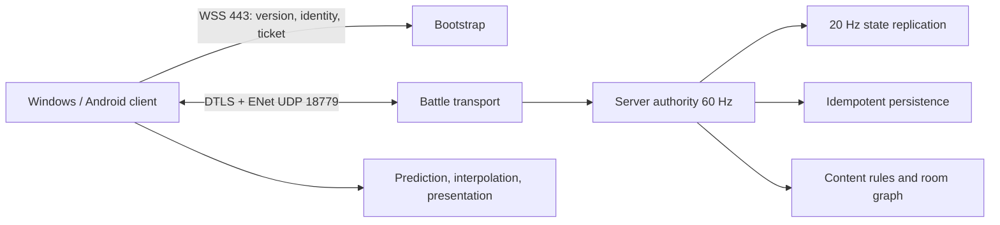

# 48 · 系统集成路线图与当前迭代计划

本篇是《香火债》在 `v0.6.0` 原生 ENet/DTLS 正式联机版之后的系统级开发入口。它把玩法、网络、存档、输入、内容、美术音频、平台和发布放到同一条可验收链路中，避免把单个功能完成误认为整套产品完成。

This document is the system-level development entry point after the `v0.6.0` native ENet/DTLS release. It joins gameplay, networking, saves, input, content, art/audio, platforms, and release gates into one evidence-based delivery path.

## 1. 基线与边界

| 系统 | 当前事实 | 证据或入口 | 本轮判断 |
| --- | --- | --- | --- |
| 权威模拟 | 服务端 60 Hz 固定 Tick；服务器裁定伤害、生命、掉落、经济、成长、门切换和结算 | `game/scripts/network/server_runtime.gd`、`46`、`47` | 保留，继续拆清输入、模拟、复制和持久事务边界 |
| 战斗传输 | WSS 443 引导身份和一次性 ticket；ENet＋DTLS/UDP 18779 承载战斗；状态、输入、控制、基线、定义、反馈分通道 | `game/scripts/network/enet_battle.gd`、`state_stream.gd`、`47` | 保留；不把所有消息重新塞回 TCP/WSS |
| 弱网与恢复 | 输入 30 Hz、六帧冗余；动态状态可丢弃；WSS 身份和 ENet 战斗腿分离；90 秒恢复宽限 | `online_session.gd`、`network_faults.gd`、`udp_soak.gd` | 保留；收紧票据生命周期，继续补齐长时和容量证据 |
| 持久化 | 双代 registry、房间修订、幂等 request、服务重启恢复、存储故障冻结 | `save_store.gd`、`server_runtime.gd`、`application-network-faults.json` | 保留；网络输入不得直接写单机愿簿 |
| 玩法内容 | 十一层、独立主题、内墙边界、60/40 混编、独立 Boss 房、可组合攻击、商店/献灯/判官/观音等房间 | `23`—`27`、`data/` | 作为权威模拟的内容输入，继续以数据驱动扩展 |
| UI/输入 | 键盘方向键/Tab/I/Esc/Enter、数字 1—4 选择；手机左手移动、右手技能/瞄准；现代圆角图标 UI | `09`、`22`、`38`、`run_keyboard_qa.py` | PC 纯键盘闭环已验证；移动文件选择器、软键盘和真机布局仍需设备验收 |
| 交付 | Windows、Android arm64、Linux/Windows server 包和源码归档均有稳定 `v0.6.0` | GitHub `v0.6.0` Release、`server/archives/v0.6.0` | 当前稳定版不覆盖；新运行时改动走独立 patch candidate |

本轮继续遵守以下边界：只使用 Windows 原生工具，不调用 Docker、WSL、虚拟机或模拟器；不把没有接入的摩托罗拉 X30 真机写成已验收；公网候选测试和正式 `/play` 激活分开记录；不提交 TLS 私钥、玩家 token、检查点或签名材料。

## 2. 路径评估与选择

| 路径 | 能解决的问题 | 引入的成本/风险 | 结论 |
| --- | --- | --- | --- |
| WSS/TCP 承载全部战斗 | 443 可达，部署简单 | 可靠流队头等待；状态、输入和控制互相阻塞；已有卡顿问题会复现 | 只保留为引导和身份恢复 |
| **Godot ENet＋DTLS** | 原生 UDP、可靠/不可靠通道、重传、统计和加密 | 需要开放 UDP、做同步和运营证据 | **当前 Windows/Android 首选，已发布并继续迭代** |
| KCP 或自定义 ARQ | 可调拥塞和重传 | 需要原生扩展、加密、认证、通道、MTU 和完整测试；错误的可靠流仍会队头等待 | 当前不替换 ENet |
| netfox/回滚框架 | 可复用时钟、预测、校正 | 当前世界含大量 Dictionary、NPC、弹幕和持久副作用；整局回滚成本高 | 仅作为角色层实验，不作为全世界裁定 |
| Steam Networking/SDR | 继电器、认证和路由 | Steam 依赖及发行条件；非 Steam Android 不能默认复用 | 将来 Steam 版单独评估 |
| WebRTC DataChannel | 浏览器和 NAT 穿透 | 原生扩展、信令、STUN/TURN 和 TCP 回退路径 | 将来 Web 版评估，不替换当前原生包 |

选择 ENet 的理由是它已经随 Godot 提供，能保持服务器权威和跨 Windows/Android 的独立部署；当前延迟、卡顿和丢包问题主要来自消息边界、快照策略、重连生命周期和证据不足，不是换一个 ARQ 名称就会消失。

## 3. 目标边界



客户端只预测本机移动、朝向和视觉攻击反馈；服务器决定碰撞、命中、伤害、掉落、金币、成长、暂停、换房和结算。动态状态带 tick、scene、epoch、entity sequence；基线和定义可靠分块；控制事务带 request ID 并在持久提交后确认。

每个连接最多有一个未消费 battle ticket。重新授权前先撤销同一连接的旧票据；断开身份时立即撤销全部票据；错误票据、错误 link、超时和绑定失败分别计数。票据不是房间密码，也不能绕过 WSS 身份、owner generation 或房间状态检查。

## 4. 已发现的缺口与优先级

| 优先级 | 缺口 | 影响 | 处理 |
| --- | --- | --- | --- |
| P0 | 旧连接/异常重试的旧 battle ticket 没有显式按连接撤销 | 旧票据在过期前仍留在内存，扩大重连竞态排查面 | **本轮已实现单连接单待票据、断开撤销和旧票据回归** |
| P0 | 健康端点只能看到总 UDP 拒绝，不能区分 ticket、link、超时 | 无法判断是攻击流量、客户端绑定失败还是公网丢包 | **本轮已增加 issued、active、revocations、reissues、bind failures 和分原因 rejection** |
| P0 | 历史公网 WAN 证据使用候选地址，正式服务已切 `/play` | 读者可能把候选结果误解为生产 SLA | **本轮为报告增加候选范围标记，并在 47/48 明确正式激活边界** |
| P1 | 尚未完成 30 分钟弱网、60 分钟双房满载和不同地域矩阵 | 不能据此承诺容量或所有运营商体验 | 列入下一次 release gate，不伪造数据 |
| P1 | Android 资源和脚本已静态检查，真机未连接 | 黑边、系统返回、后台、蜂窝切换和触控手感仍没有设备证据 | 按用户决定保留 `physical_android_tested=false`，发布说明明确限制 |
| P1 | 生产健康端点缺少按阶段的客户端反馈聚合 | 服务器知道 RTT/丢包，但难以解释用户看到的冻结/恢复 | 下一轮增加匿名聚合：状态年龄、重绑次数、保护原因、输入校正 |
| P2 | 内容扩展、平衡和美术音频生产仍需要真人体验 | 数量和代码覆盖不能替代爽感、辨识度和节奏验收 | 沿用 00—38 的内容工作流，以可重放种子和实机媒体验收 |

## 5. 本轮实现：票据生命周期与观测

### 5.1 代码变更

- `server_runtime.gd` 新增 `issue_battle_ticket()` 和 `revoke_battle_tickets()`；每次 `welcome` 或 `battle_grant` 先清理同一连接的旧票据。
- `disconnect_peer()` 立即撤销该连接的待票据，避免已失效身份的票据在内存中等待自然过期。
- 无效/过期/断开连接 ticket、错误 link/重复绑定、未绑定 ENet 超时分别累计，健康端点返回有界字典，不包含票据原文。
- 不改变协议版本、加密方式、房间裁定、客户端输入格式或生产 `v0.6.0` 二进制；这是下一 patch candidate 的服务端修复，不能直接覆盖稳定 Release。

### 5.2 回归覆盖

`game/tests/udp_security.gd` 新增以下闭环：

1. 给同一已认证但尚未绑定的连接重新发放 ticket；
2. 确认旧 hash 已撤销且新 hash 唯一存在；
3. 使用旧 ticket 的另一条 DTLS peer 被拒绝，新的 ticket 仍可用；
4. 保留原有伪造 ticket、已消费 ticket、错误 link、错误通道、Variant 禁止、截断输入、未知 TLS record、身份接管和过期 ticket 检查。

原始运行结果写入 `.local-tools/udp-development/delivery/iteration-ticket-security-20261012/`（本机临时目录）；去除机器私有路径后的检查清单已归档到 [ticket-lifecycle-iteration.json](reports/network-udp-acceptance-2026-10-12/ticket-lifecycle-iteration.json)。

完整 UDP 回归（状态流、插值、攻击预测、合作传输、网络故障、票据安全、UDP 不可达和 DTLS 证书负例）已通过，机器报告见 [system-integration-regression.json](reports/network-udp-acceptance-2026-10-12/system-integration-regression.json)。

## 6. 后续开发计划

| 阶段 | 文件/系统 | 实施内容 | 退出条件 |
| --- | --- | --- | --- |
| I1 票据与观测 | `server_runtime.gd`、`udp_security.gd`、health | 单连接单待票据、撤销、分原因计数 | 安全回归全通过；health 不泄露 token |
| I2 传输质量 | `state_stream.gd`、`remote_interpolation.gd`、`attack_prediction.gd` | 记录状态 age/间隔、丢弃/合并/重排、预测校正和重绑；关键事件保持幂等 | 200 ms RTT + 3—5% 丢弃无系统性停输入；状态黑洞有界冻结 |
| I3 权威与持久 | `cooperative_match.gd`、`server_runtime.gd`、`save_store.gd` | 输入 epoch/scene、门切换、掉落、购买、救援、结算统一由 authority 提交；重启从同一 revision 恢复 | 旧房包、重复请求、进程重启、写盘失败不重复奖励、不丢结算 |
| I4 内容与表现 | `room_graph.gd`、`world.gd`、`attack_composer.gd`、`data/`、`assets/` | 以主题/房间/攻击配置驱动；为射线、范围、爆炸、掉落、怪物和 Boss 保持独立视觉反馈与声音事件 | 11 层、双 Boss 独立房、60/40 混编、特殊房和组合攻击可用种子重放 |
| I5 输入与可访问性 | `online_controller.gd`、`choice_shortcuts.gd`、移动布局 | PC 上下左右/Enter/Esc/Tab/I/数字 1—4 全流程闭环；移动端安全区、右手技能、失焦清零 | `run_keyboard_qa.py` 全通过；移动软件回归通过；真机状态如实标记 |
| I6 观测与容量 | `health()`、runtime tools、部署脚本 | 30 分钟弱网、60 分钟双房、地域/运营商和 MTU 记录；匿名化错误分类 | 服务器 step p99 <8 ms、p999 <16.7 ms；fresh playable frame ≥99.5%（矩阵内） |
| I7 patch release | package/build/archive/release | 只把 I1—I6 的证据绑定到新版本；候选隔离、健康、回滚、Release 清单齐全 | 新版本通过客户端/服务端协议与内容指纹门禁，稳定 tag 不被覆盖 |

## 7. 验收矩阵

每个候选版本都要保存命令、源码哈希、运行时日志和机器可读结果：

```powershell
python tools/runtime/run_udp_regression.py --output .local-tools/udp-development/delivery/<run>
python tools/runtime/verify_server_archive.py --version <version>
python tools/runtime/verify_packaged_revision.py --output docs/incense-debt/reports/platforms/windows-<version>
python tools/runtime/run_keyboard_qa.py --packaged --output docs/incense-debt/reports/platforms/windows-<version>/keyboard
python tools/runtime/verify_android.py --skip-device-discovery
```

网络矩阵至少覆盖回环、RTT 50/100/200/350 ms、抖动 0/20/50 ms、随机丢弃 0/1/3/5/10%、重复/乱序以及 0.3/1/3 秒突发断流。场景矩阵必须包含密集弹幕、射线、范围爆炸、可操控弹丸、共享拾取、技能选择、暂停/恢复、走门、死亡、重连和结算。所有外部 WAN 数字都标明是候选、正式生产或历史基线。

稳定版准入前必须同时看到：

- 服务器 60 Hz；模拟步 p99 <8 ms，p999 在 16.7 ms 内；超过 100 ms 的战斗阻塞为 0。
- 输入保护、状态冻结和重绑均有上限；不因一个丢包让房间永久停滞，也不让客户端无限外推。
- 交易、掉落、金币、技能、结算和成就按 request/action ID 幂等；旧 epoch、旧 scene、旧 link 均被拒绝。
- Windows/Android 共享协议和内容指纹一致；Android 真机结果单独填写，未测试就保持 false。
- 候选和正式 `/play` 的 endpoint、版本、SHA、备份和回滚路径独立记录。

## 8. 发布与回滚规则

当前 `v0.6.0` 仍是稳定生产版本；本轮源码和回归属于下一 patch candidate，不能通过改远端文件或重用旧 tag 的方式覆盖正式包。若 I1 需要部署，使用新版本号、独立 `/candidates/<version>`、独立私有数据备份和新的 server archive；候选健康、UDP 回归、服务重启和回滚验证完成后，才允许切换 `/play`。

回滚顺序固定为：停止接入 → 保存/校验当前 checkpoint → 恢复旧 binary/config → 健康检查 → 小流量连接 → 再开放大厅。任何无法解释的 storage fault、content mismatch、ticket 绑定异常增长或客户端错误都阻止晋级。

## 9. 本轮完成状态

| 项目 | 状态 |
| --- | --- |
| 路径评估与 ENet/DTLS 选型 | 已完成并与 45—47 对齐 |
| 系统级规划文档 | 本篇已建立 |
| 单连接单待票据和旧票据撤销 | 已实现 |
| ticket/绑定故障观测 | 已实现 |
| 旧 ticket 复用安全回归 | 已实现并通过 |
| 正式生产切换 | 保持 `v0.6.0`，等待下一 patch 完整 gate |
| 摩托罗拉 X30 真机验证 | 按用户决定不执行，明确记录为限制 |
